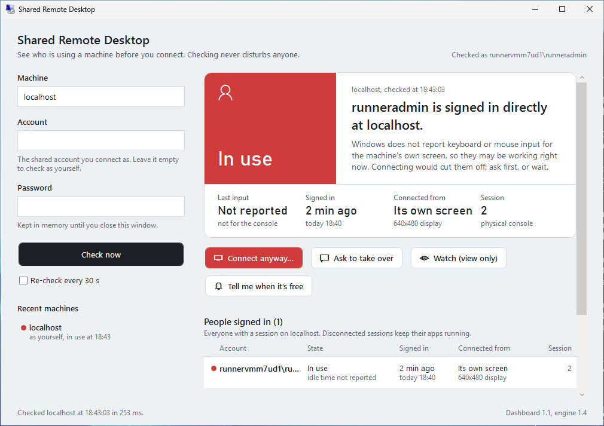

# SharedRDP

See who is using a machine before you connect. Checking never disturbs anyone.

When several people share one account on a Remote Desktop machine, connecting
as that account silently takes over the session of whoever is working: Windows
only asks the signed-in person first when the incoming account is a different
one. These scripts read the machine's session list instead, which never touches
a session, and say in plain words whether it is free, in use, idle, locked or
disconnected, who is connected, from which computer, and since when.

<picture>
  <source media="(prefers-color-scheme: dark)" srcset="docs/dashboard-dark.png">
  
</picture>

*The dashboard checking a GitHub Actions runner, from the checks in `tests/`.*

## What's here

| File | What it is |
|---|---|
| `SharedRdp-Dashboard.cmd` | Double-click this to open the dashboard. |
| `SharedRdp-Dashboard.ps1` | The dashboard: type a machine, an account and its password, get the answer. |
| `Connect-SharedRdp.ps1` | The command-line version. The dashboard runs its checks through it. |
| `tests/` | The checks that run on Windows for every change (see [Checks](#checks)). |

Keep the three scripts in one folder.

## Get started

You need Windows 10 or 11 or Windows Server, with Windows PowerShell 5.1 (built
in) or PowerShell 7.

1. Download the repository (**Code > Download ZIP**) and extract it.
2. Unblock the downloaded files, or Windows may refuse to run them: right-click
   each one, open **Properties** and tick **Unblock**. Or, in PowerShell in that
   folder: `Get-ChildItem | Unblock-File`
3. Double-click `SharedRdp-Dashboard.cmd`.

From a console instead:

```powershell
powershell.exe -ExecutionPolicy Bypass -File .\SharedRdp-Dashboard.ps1
powershell.exe -ExecutionPolicy Bypass -File .\Connect-SharedRdp.ps1 LAB-07
```

## One-time setup on each shared machine

A check reads the session list over the network, the way `quser /server:LAB-07`
does. As an administrator on each shared machine:

- **Windows 10 and 11** refuse remote session queries until `AllowRemoteRPC` is 1:

  ```powershell
  Set-ItemProperty 'HKLM:\SYSTEM\CurrentControlSet\Control\Terminal Server' -Name AllowRemoteRPC -Value 1
  ```

- **TCP 445** has to be reachable from the people who check: the firewall rule
  *File and Printer Sharing (SMB-In)*.
- **Permission:** checking as the shared account itself always works, because
  you then look at that account's own session. To see the sessions of other
  accounts, the checking account needs the *Query Information* permission on
  the RDP listener; members of Remote Desktop Users have it.
- **Optional**, for *Look up their last client in the event log*: the
  *Remote Event Log Management* firewall rules, and an administrator account
  (or a member of Event Log Readers) on that machine.

## What the answers mean

| Status | Meaning | If you connect now |
|---|---|---|
| Free | That account has no session (or nobody is signed in) | A new session starts; nobody is disconnected |
| Disconnected | Nobody is watching; the apps are still running | You pick up that desktop where it was left |
| Locked | Someone is connected, with the screen locked | Their window is cut off; their apps keep running |
| Idle | Connected and unlocked, but no input for 5 minutes or more | They are cut off; better ask first |
| In use | Keyboard or mouse input within the last 5 minutes | They are cut off without warning |
| Busy | A process you named, such as a test runner, is running there | It may break |
| Signing in | Someone is at the sign-in screen, or the session is changing state (`CONNECTING` on the command line) | Wait a few seconds and check again |
| Unknown | The check failed | Nothing is known; the reason and the fix are shown |

Every answer also lists everyone else who is signed in, and the sessions with
nobody in them.

### Sessions with nobody in them

Every Windows machine has sessions that no person is signed in to. Windows
reports them with an empty user name, which older versions of the `-Verbose`
log showed as `"\"`. You will typically see:

- **Session 0, Services:** where Windows services run. It is never a person.
- **Console:** the machine's own screen and keyboard. With nobody signed in
  there, it shows the sign-in screen.
- **RDP-Tcp, state Listen:** the Remote Desktop listener, waiting for
  connections.
- **RDP-Tcp#N, state Connected:** someone who is connecting right now and has
  not signed in yet. This is the one that turns *Free* into *Signing in*.

None of them block a connection. The dashboard lists them under *Not people*.

## The dashboard

Type the machine (name or IP address, optionally with `:port`), the account and
its password, then press **Check now** (or Enter, or F5). Leave the account
empty to check as yourself; then every session on the machine counts, and the
busiest one decides.

- **Connect** opens Remote Desktop with the machine and the account filled in,
  using your own defaults from `Documents\Default.rdp`. When that would cut
  someone off, it asks you first.
- **Ask to take over** shows a Yes/No box in their session. If they click Yes,
  Remote Desktop opens for you. It waits 60 seconds for an answer.
- **Watch (view only)** opens a view-only copy of their screen
  (`mstsc /shadow`). It needs administrator rights there, and by default the
  other person is asked first.
- **Tell me when it's free** checks again every 30 seconds and plays a sound,
  flashes the taskbar button and shows a notification when the session is free
  or disconnected. It keeps watching that machine while you check others. Keep
  the window open.
- **Look up their last client in the event log** appears when Windows no longer
  reports where a session was connected from, which is always the case for
  disconnected sessions.
- **Show the step-by-step log** has every step of every check, with buttons to
  copy it or save it to a file.

The password is kept in memory until the window closes and is never written to
disk. When the machine rejects it, the dashboard forgets it and stops checking
that machine on its own (*Re-check* and *Tell me when it's free*) until you
type it again: wrong passwords tried every 30 seconds would soon lock the
account out. The machine and account names of recent checks are saved in
`%APPDATA%\SharedRdp\dashboard.json`, so you can check them again with one
click, or with the arrow keys and Enter. A bare account name such as
`Administrator` means a local account on that machine, shown as
`MACHINE\Administrator`.

Options, for a shortcut or the console:

| Parameter | Meaning |
|---|---|
| `-ComputerName` | Machine to fill in. Without `-UserName`, it is checked right away. |
| `-UserName` | Account to fill in, for example `LAB-07\tester`. |
| `-RefreshSeconds` | How often *Re-check* and *Tell me when it's free* check again. Default 30. |
| `-IdleMinutes` | No input for this long counts as idle. Default 5. |
| `-BusyProcess` | Process names that mean automation is running, for example `TestExecute, vstest.console`. |
| `-AskTimeoutSeconds` | How long *Ask to take over* waits. Default 60. |
| `-EnginePath` | Where `Connect-SharedRdp.ps1` is, when it is not next to the dashboard. |

## The command line

```powershell
.\Connect-SharedRdp.ps1 LAB-07
.\Connect-SharedRdp.ps1 -RdpFile \\fileserver\rdp\LAB-07.rdp
.\Connect-SharedRdp.ps1 LAB-01,LAB-02,LAB-03 -StatusOnly
.\Connect-SharedRdp.ps1 LAB-07 -Credential LAB-07\tester -BusyProcess TestExecute,vstest.console
.\Connect-SharedRdp.ps1 192.168.222.90 -StatusOnly -Verbose -LogPath .\rdp-check.log
```

If the machine is free, or disconnected for longer than 15 minutes, Remote
Desktop starts right away. Otherwise you choose: connect anyway, ask them, watch,
get notified when it is free, refresh, or quit. With several machines you get a
table and pick one; Enter takes the suggested free machine. *Notify me* stops
as soon as the machine rejects the `-Credential` password, so that it cannot
lock the account out.

| Parameter | Meaning |
|---|---|
| `-ComputerName` | One or more machines, as `host` or `host:port`. |
| `-RdpFile` | An .rdp file to connect with. Its `full address` is used when `-ComputerName` is left out, and its `username` names the shared account. |
| `-UserName` | The shared account, for example `LAB-07\tester`. Only its session counts as the one you would take over. Defaults to the .rdp file's user name, then to `-Credential`'s. |
| `-Credential` | Account used for the check only, not for signing in to Remote Desktop. A bare user name means a local account on the target. |
| `-StatusOnly` | Only report: outputs one object per machine for scripts, chat bots or `ConvertTo-Json`. Nothing is started. |
| `-IdleMinutes` | No input for this long turns *In use* into *Idle*. Default 5. |
| `-RecentDisconnectMinutes` | A session disconnected more recently than this asks before connecting, because its owner may be coming back. 0 never asks. Default 15. |
| `-BusyProcess` | Process names that mean automation is running; wildcards allowed, `.exe` optional. |
| `-AskTimeoutSeconds` | How long *Ask them* waits for an answer. Default 60. |
| `-PollSeconds` | How often *Notify me* checks again. Default 30. |
| `-NoConsentPrompt` | *Watch* without asking the other person, if Group Policy allows it. |
| `-MstscArgument` | Extra `mstsc.exe` arguments, for example `/f` or `/multimon`. |
| `-SkipPortCheck` | Skip the quick test of TCP 445 and 135 before each check. |
| `-LogPath` | Also append every log line to this file, with timestamps. |

`Get-Help .\Connect-SharedRdp.ps1 -Full` shows the same in the console.

## When a check fails

The answer is *Unknown*, with the Windows error, its code and what to do. The
step-by-step log (or `-Verbose` and `-LogPath` on the command line) shows every
step: name resolution, the port test, the account used, the raw session data or
the full error.

| Error | What it usually means | What to do |
|---|---|---|
| 259, *No more data is available* | The machine answered, but this account may not see any session there | Check as the shared account, or as a member of Remote Desktop Users there. On Windows 10 and 11, set `AllowRemoteRPC` to 1. |
| 5, *Access is denied* | Remote session queries are off, or the account lacks permission | Set `AllowRemoteRPC` to 1; check as the shared account. |
| 1326 and other sign-in errors | Wrong user name or password, or an account that machine does not know | For a local account, use `MACHINE\user` or just the name. |
| 1722, *The RPC server is unavailable* | The session service did not answer the remote query | Set `AllowRemoteRPC` to 1, make sure Remote Desktop is enabled there and SMB-In is allowed. |
| 53, *The network path was not found* | The name does not resolve, or TCP 445 is blocked on the way | Check the name and the firewall. |
| 1219, *Multiple connections* | You already have a connection to that machine under another user name, such as a mapped drive | Disconnect it, or check with the same account. |
| TCP 445 and 135 closed | The machine is off, or a firewall blocks both | Turn it on, or allow *File and Printer Sharing (SMB-In)*. |

Through an RD Gateway the check cannot reach the machine.

## How it works

- **The check** calls the Remote Desktop Services API: `WTSEnumerateSessions`
  and `WTSQuerySessionInformation` give each session's state, lock state,
  sign-in, connect, disconnect and last-input times, and the client's name,
  address and screen size. Only reads; no session is touched.
- **A password** is used for a *new credentials* sign-in, like
  `runas /netonly`: only the network connection to that machine signs in with
  it, and it is never written to disk.
- **Ask to take over** sends a Yes/No message box into the session with
  `WTSSendMessage`.
- **Watch** starts `mstsc /shadow`.
- **Busy** looks for the named processes with `WTSEnumerateProcesses`.
- **The event log lookup** reads sign-in, disconnect and reconnect events (21,
  24, 25) from `Microsoft-Windows-TerminalServices-LocalSessionManager/Operational`.

## Checks

Every pull request and every push to `main` runs the scripts in `tests/` on a
GitHub-hosted Windows runner:

- `Test-Scripts.ps1`: syntax in Windows PowerShell 5.1 and PowerShell 7,
  ASCII-only files, both C# parts compiled, the window layout loaded in the
  light and dark theme at two sizes, the status logic and the dashboard's
  wording on made-up sessions, the port test over IPv4 and IPv6, and a
  background check of the runner.
- `Invoke-Analyzer.ps1`: PSScriptAnalyzer with every rule except the few that
  `PSScriptAnalyzerSettings.psd1` leaves out, each with its reason; errors and
  warnings fail the run.
- `Test-CommandLine.ps1`: the command line against the runner, locally and
  over the network, with a temporary account, a wrong password that has to
  come back as a rejected sign-in, and a takeover request that times out.
- `Test-Dashboard.ps1`: opens the dashboard through the .cmd file, lets it
  check the runner, starts and stops watching, checks again from the list of
  recent machines with a click and with Enter, reads the window through UI
  Automation, and takes screenshots in both themes.

The screenshots and logs are kept with each run, under *Artifacts*. To run the
checks that change nothing on your own computer:

```powershell
powershell.exe -ExecutionPolicy Bypass -File .\tests\Test-Scripts.ps1 -OutputPath .\out
```

`Test-CommandLine.ps1 -CiSetup` changes the machine (it sets `AllowRemoteRPC`
and creates a temporary account), so it is meant for throw-away CI machines.

## License

GPL-3.0. See [LICENSE](LICENSE).
